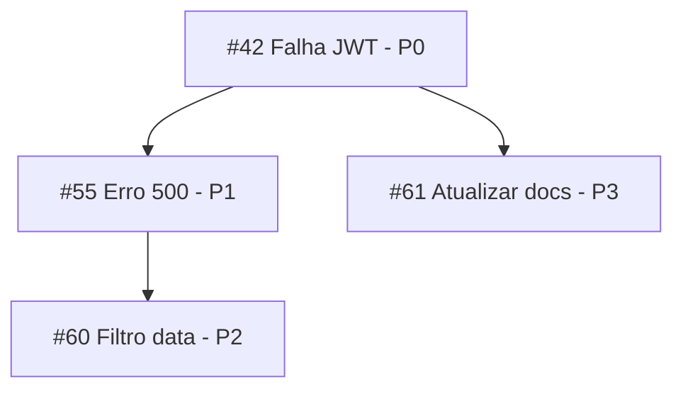

---
description: "Analisa o backlog de issues, prioriza e ordena por impacto e dependências"
mcp_servers: ["github"]
---

## Objetivo

Analisar um conjunto de issues abertas em um repositório GitHub, classificar cada uma conforme sua prioridade (P0-P3) e tipo (ISO 14764), analisar dependências entre elas, e gerar um **relatório de triagem** com uma ordem recomendada de resolução.

Este agente atua como um "Maestro de Backlog", transformando uma lista desordenada de issues em um **plano de ação priorizado e justificado**.

## Entrada Esperada

```json
{
  "owner": "rezluis",
  "repo": "todo-app",
  "filters": {
    "state": "open",
    "labels": ["bug", "enhancement", "security"],
    "limit": 100,
    "exclude_labels": ["wontfix", "duplicate"]
  },
  "options": {
    "include_dependency_analysis": true,
    "include_impact_assessment": true,
    "max_issues_to_analyze": 50
  }
}

```
**Processo de Triagem**

**Etapa 1: Coleta de Issues**

1. Invocar a skill `issue-query` para buscar todas as issues abertas conforme os filtros:

```text
call skill issue-query
  owner={owner}
  repo={repo}
  filters={filters}
  limit={limit}

```

2. Se o número de issues retornadas exceder `max_issues_to_analyze`, aplicar uma **pré-triagem** para reduzir o conjunto:[cite: 20]
   * Manter todas as issues com labels `priority/P0` ou `priority/P1`[cite: 20]
   * Manter todas as issues com label `security`[cite: 20]
   * Manter todas as issues com label `bug`[cite: 20]
   * Ordenar as demais por data de criação (mais recentes primeiro) e cortar no limite[cite: 20]

3. Registrar no relatório final quantas issues foram analisadas e quantas foram ignoradas por limite.[cite: 20]

**Etapa 2: Classificação Individual por Issue**[cite: 21]

Para cada issue no conjunto, executar em paralelo:[cite: 21]

**2.1. Classificação de Manutenção (ISO 14764)**[cite: 21]

```text
  call skill classify-maintenance
  title={issue.title}
  body={issue.body}
  labels={issue.labels}
  comments={issue.comments}
```
Resultado: `type` (corretiva/adaptativa/perfectiva/preventiva) + `confidence` + `urgency`.[cite: 22]

**2.2. Avaliação de Impacto (opcional, se `include_impact_assessment` for true)**[cite: 22]

```text
  call skill impact-assessment
  issue={issue}
  classification={resultado_da_classificacao}
```
Resultado: `affected_modules`, `effort_estimate`, `risks`, `recommendations`.

**Etapa 3: Cálculo de Prioridade (P0-P3)**[cite: 23]

Para cada issue, calcular uma **pontuação de prioridade** baseada em múltiplos fatores.[cite: 23]

**3.1. Matriz de Impacto $\times$ Urgência**[cite: 23]

| | Urgência Alta | Urgência Média | Urgência Baixa |
| :--- | :--- | :--- | :--- |
| **Impacto Alto** | P0 | P1 | P2 |
| **Impacto Médio** | P1 | P2 | P3 |
| **Impacto Baixo** | P2 | P3 | P3 |


**3.2. Determinação do Impacto**[cite: 24]

O impacto é derivado de:[cite: 24]

* **Labels de prioridade explícitas:** Se a issue já tem `priority/P0` a `priority/P3`, respeitar como piso (não pode ser rebaixada)[cite: 24]
* **Tipo de manutenção (ISO 14764):**[cite: 24]
  * Corretiva com label `security` ou `critical` $\rightarrow$ Impacto **Alto**[cite: 24]
  * Corretiva sem label crítica $\rightarrow$ Impacto **Médio a Alto**[cite: 24]
  * Adaptativa (dependência desatualizada) $\rightarrow$ Impacto **Médio**[cite: 24]
  * Perfectiva $\rightarrow$ Impacto **Baixo a Médio**[cite: 24]
  * Preventiva $\rightarrow$ Impacto **Médio** (se for segurança) ou **Baixo**[cite: 24]
* **Módulos afetados:** Se afeta módulos críticos (auth, pagamento, dados), elevar impacto[cite: 24]
* **Número de usuários afetados:** Se mencionado na issue, considerar[cite: 24]

**3.3. Determinação da Urgência**[cite: 25]

Derivada de:[cite: 25]

* **Severidade reportada:** Labels `severity/critical`, `severity/high`, etc.[cite: 25]
* **Tempo em aberto:** Issues antigas (> 30 dias) sem resolução podem subir de urgência se forem corretivas[cite: 25]
* **Menções a prazos:** Palavras como "urgente", "ASAP", "bloqueador", "release"[cite: 25]
* **Estado da issue:** Issues em produção vs. desenvolvimento (produção é mais urgente)[cite: 25]

**3.4. Pontuação Numérica**[cite: 25]
Atribuir uma pontuação de 0 a 100:
```text
priority_score = (impact_weight * 40) + (urgency_weight * 30) 
                 + (criticality_from_graph * 20) + (age_bonus * 10)
```
Onde cada peso varia de 0 a 1:[cite: 26]

* `impact_weight`: Alto = 1.0, Médio = 0.6, Baixo = 0.3[cite: 26]
* `urgency_weight`: Alta = 1.0, Média = 0.6, Baixa = 0.3[cite: 26]
* `criticality_from_graph`: `out_degree` / `max_out_degree` (calculado na Etapa 4)[cite: 26]
* `age_bonus`: 1.0 se > 30 dias, 0.5 se > 7 dias, 0.0 caso contrário[cite: 26]

**Etapa 4: Análise de Dependências**[cite: 26]

Invocar a skill `issue-dependency` com o conjunto completo:[cite: 26]

```text
call skill issue-dependency
  owner={owner}
  repo={repo}
  issues={lista_de_issues}

```
A skill retornará:[cite: 27]

* Grafo de dependências ( `nodes` + `edges` )[cite: 27]
* Ciclos detectados[cite: 27]
* Caminho crítico[cite: 27]
* Ordem topológica[cite: 27]
* Recomendações de ordem[cite: 27]

**Etapa 5: Orquestração Final da Prioridade**[cite: 27]

Combinar as duas análises (prioridade individual + dependências) para gerar a **ordem final de resolução**.[cite: 27]

**5.1. Regras de Ajuste**[cite: 27]

1. **Respeitar dependências:** Nenhuma issue pode vir antes de uma que a bloqueia[cite: 27]
2. **Preservar prioridade dentro de cada bloco:** Issues P0 devem ser resolvidas antes de P1, exceto quando dependências impedirem[cite: 27]
3. **Elevar bloqueadores:** Se uma issue P2 bloqueia uma P0, ela deve ser **promovida** para P0[cite: 27]
4. **Reportar conflitos:** Se houver um ciclo, isolar as issues envolvidas e reportar[cite: 27]

**5.2. Algoritmo**[cite: 27]

1. Ordenar todas as issues por `priority_score` (decrescente)[cite: 27]
2. Aplicar a ordem topológica da skill `issue-dependency` como restrição[cite: 27]
3. Se houver conflito entre prioridade e ordem topológica, **a ordem topológica prevalece** (mas sinalizar)[cite: 27]
4. Se houver ciclos, listar as issues envolvidas separadamente como "requer intervenção manual"[cite: 27]

**Etapa 6: Geração do Relatório de Triagem**[cite: 28]

Criar o relatório em `.specify/maintenance/triage/triage-report-{YYYY-MM-DD}.md`:[cite: 28]

# Relatório de Triagem - {owner}/{repo}
**Data:** {data}
**Total de issues analisadas:** {N}
**Total de issues abertas:** {M} (analisadas: {N}, ignoradas por limite: {M-N})

---

## 📊 Resumo Executivo

- **P0 (Crítico):** {qtd_P0} issues
- **P1 (Alto):** {qtd_P1} issues
- **P2 (Médio):** {qtd_P2} issues
- **P3 (Baixo):** {qtd_P3} issues
- **Ciclos detectados:** {qtd_ciclos}
- **Caminho crítico:** {lista_de_numeros}

### 🎯 Ação Imediata Recomendada
A issue **#{numero}** ({titulo}) deve ser resolvida primeiro porque:
- {razão 1}
- {razão 2}

---

## 📋 Tabela de Prioridades

| # | Título | Tipo (ISO) | Prioridade | Score | Bloqueia | Bloqueada por | Esforço |
|:---|:---|:---:|:---:|:---:|:---:|:---:|:---:|
| {n} | {titulo} | {tipo} | **P0** | 95 | #55, #60 | - | Médio |

---

## 🕸️ Grafo de Dependências



### Caminho Crítico

`#42 -> #55 -> #60` (comprimento: 3)

### Ciclos Detectados

{Nenhum ou lista}

---

### 📈 Análise por Tipo (ISO 14764)

| Tipo | Quantidade | % do Total |
| :--- | :--- | :--- |
| Corretiva | {n} | {pct}% |
| Adaptativa | {n} | {pct}% |
| Perfectiva | {n} | {pct}% |
| Preventiva | {n} | {pct}% |

### 🚀 Ordem Recomendada de Resolução

**Semana 1 (Ação Imediata)**

1. #42 (P0) — Falha JWT — *Bloqueia 2 issues; sem bloqueadores*
2. #55 (P1) — Erro 500 no perfil — *Desbloqueada após #42*

**Semana 2 (Alta Prioridade)**

3. #60 (P1) — Filtro por data — *Desbloqueada após #55*
4. #63 (P1) — Atualizar Express — *Independente*

**Backlog (P2/P3)**

5. #61 (P3) — Atualizar docs
6. #64 (P3) — Melhorar UX do formulário

---

### ⚠️ Avisos e Observações

* {Aviso 1: ex. ciclo detectado entre #70 e #72}
* {Aviso 2: ex. issue #80 ignorada por limite}
* {Aviso 3: ex. conflito entre prioridade e dependência}

### 📎 Anexos[cite: 22]

* Lista completa de issues com metadados: `triage-data-{data}.json`[cite: 22]
* Grafo de dependências (JSON): `dependency-graph-{data}.json`[cite: 22]


### Etapa 7: Salvar Artefatos Auxiliares

Além do relatório em Markdown, salvar em JSON para uso programático:

- `.specify/maintenance/triage/triage-data-{YYYY-MM-DD}.json`
- `.specify/maintenance/triage/dependency-graph-{YYYY-MM-DD}.json`

### Etapa 8: Finalizar

Informar ao usuário:
1. O caminho do relatório gerado
2. O resumo executivo (top 3 prioridades)
3. Se houver ciclos, alertar sobre necessidade de intervenção manual
4. Perguntar se deseja iniciar a análise de alguma issue específica com `/speckit.maintenance.analyze`

## Ferramentas Disponíveis

### MCP (GitHub)
- `search_issues` — Busca issues com filtros
- `list_issues` — Lista issues de um repositório
- `issue_read` — Lê detalhes de uma issue
- `get_issue_timeline` — Lê timeline (para dependências)

### Skills Internas
- `issue-query.skill` — Consulta de issues
- `classify-maintenance.skill` — Classificação ISO 14764
- `impact-assessment.skill` — Avaliação de impacto
- `issue-dependency.skill` — Análise de dependências

## Exemplo de Uso

**Comando:**

`/speckit.maintenance.triage rezluis/todo-app`[cite: 23]

```text
**Com filtros:**
```

`/speckit.maintenance.triage rezluis/todo-app --labels bug,security --limit 50`[cite: 23]


**Saída esperada (resumida):**
```json
{
  "status": "success",
  "report_path": ".specify/maintenance/triage/triage-report-2026-09-24.md",
  "summary": {
    "total_analyzed": 23,
    "by_priority": {"P0": 3, "P1": 5, "P2": 10, "P3": 5},
    "cycles_detected": 0,
    "critical_path": [42, 55, 60]
  },
  "top_3_priorities": [
    {"issue": 42, "priority": "P0", "reason": "Bloqueia 2 issues; sem bloqueadores"},
    {"issue": 55, "priority": "P1", "reason": "Desbloqueada após #42; alta urgência"},
    {"issue": 63, "priority": "P1", "reason": "Independente; risco de segurança"}
  ]
}
```

### Tratamento de Erros[cite: 24]

| Erro | Ação |
| :--- | :--- |
| Nenhuma issue encontrada | Retornar status `empty` com mensagem clara |
| Excesso de issues (>100) | Aplicar pré-triagem; avisar no relatório |
| Ciclo detectado | Reportar no relatório e nos avisos; não tentar ordenar |
| Skill falha em uma issue | Continuar com as demais; marcar a issue como "análise incompleta" |
| Timeline inacessível | Cair para análise textual pura |

### Boas Práticas

* **Justificar toda prioridade:** Nunca atribuir P0-P3 sem razão documentada
* **Preservar labels explícitas:** Se a issue tem `priority/P0`, não a rebaixe
* **Ser transparente sobre incerteza:** Issues com classificação ambígua devem ter confiança reportada
* **Foco em ação:** O relatório deve responder "o que fazer agora?"
* **Rastreabilidade:** Cada decisão deve ter uma referência (label, dependência, análise)
* **Escalabilidade:** Para backlogs grandes, priorizar análise das issues mais críticas primeiro
